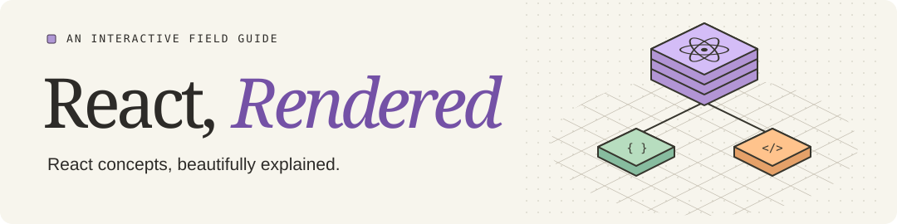
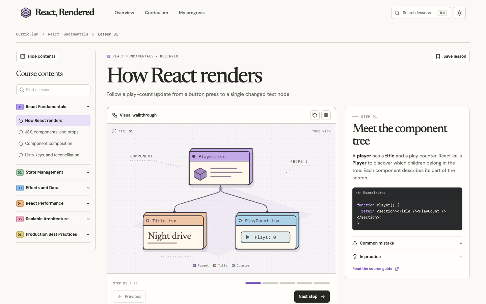
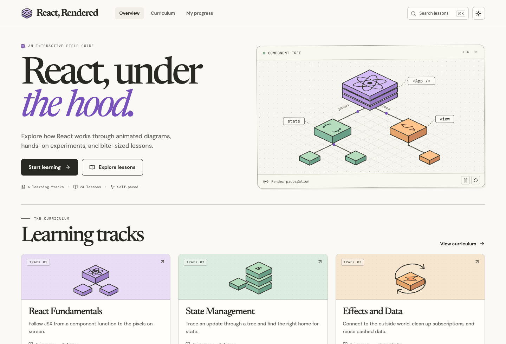
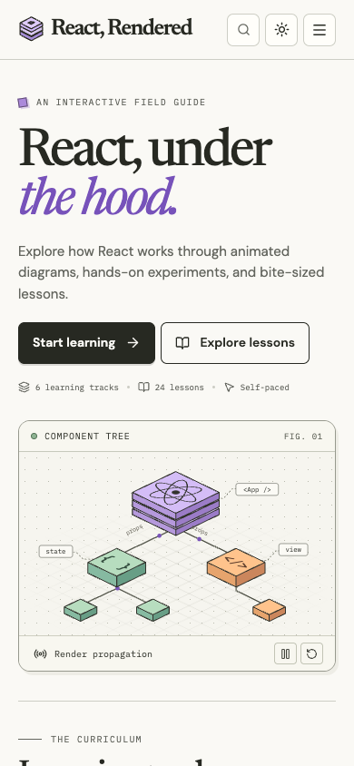
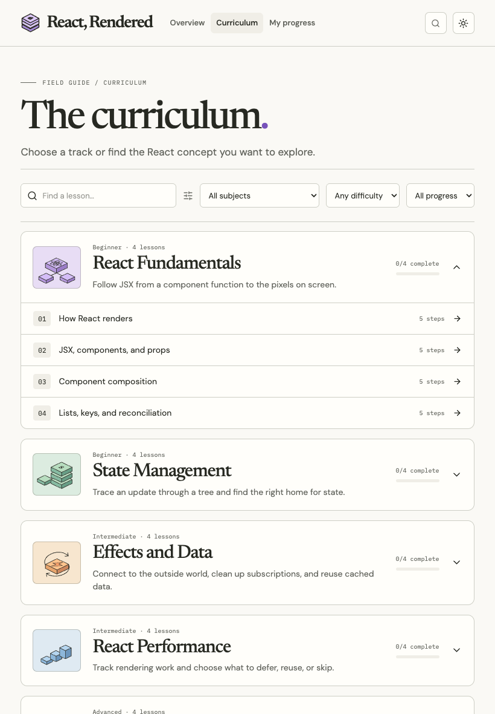
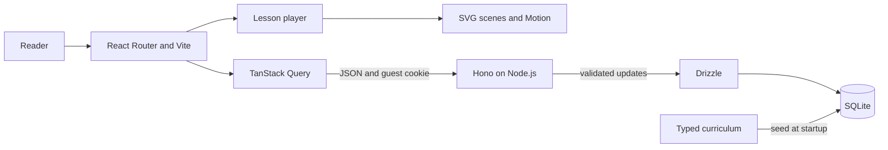

<p align="center"></p>

<h1 align="center"> React, Rendered</h1>
<p align="center"><strong>React concepts, beautifully explained.</strong><br>Step inside a render, follow a state update, and watch the DOM change.</p>
<p align="center"></p>
<p align="center"><a href="#run-it-locally">Quick start</a> · <a href="#inside-the-course">Curriculum</a> · <a href="docs/operations.md">API and deployment</a> · <a href="docs/contributing.md">Contribute</a></p>



## What changes when you click?

A counter goes from zero to one. React calls a component, compares its output, and updates a text node. The button you clicked can stay right where it was. The opening lesson takes that single interaction apart on screen.

The course follows examples from an audio editor. Switch stations to watch an effect clean up its old connection. Reorder clips to see which draft follows its key. Toggle memoization and compare render calls. Each lesson pairs an animated scene with a short code excerpt and ends with a question you can answer from the diagram.

## Run it locally

Use Node.js 24 and pnpm 10.32.1. From the repository root, run:

```sh
pnpm install --frozen-lockfile
pnpm dev
```

Open [the local field guide](http://127.0.0.1:5177). Vite serves the interface on port 5177 and forwards API requests to Hono on port 3001. The first startup creates the local SQLite database, runs migrations, and seeds the curriculum.

## Inside the course

| Track                     | Four lessons                                                                           |
| ------------------------- | -------------------------------------------------------------------------------------- |
| React Fundamentals        | Rendering and commits · JSX and props · Composition · Lists and keys                   |
| State Management          | Component state · Lifting state up · Derived state · Reducer transitions               |
| Effects and Data          | Effect lifecycle · Avoiding effects · Custom hooks · Fetching and caching              |
| React Performance         | Re-renders · Memoization · Lazy loading · Virtualized lists                            |
| Scalable Architecture     | Feature folders · Component boundaries · Context and providers · Accessible UI systems |
| Production Best Practices | Form validation · Keyboard interaction · Testing · Loading, errors, and recovery       |

<details><summary><strong>See the illustrated track overview and responsive layouts</strong></summary>



<p align="center"></p>
</details>

### At the workbench

| Experience           | Try it                                                                                                                                                     |
| -------------------- | ---------------------------------------------------------------------------------------------------------------------------------------------------------- |
| Visual walkthrough   | Use **←** and **→** to step through a diagram. Compare the highlighted nodes with the code. Replay a transition or pause motion.                           |
| Hands-on experiments | Change list keys, solo a channel, switch effect dependencies, compose children, toggle memoization, or resolve a request. The performance experiment counts simulated renders. |
| Curriculum explorer  | Filter by subject, difficulty, or progress. Press **⌘K** or **Ctrl+K** to search by concept, then use the arrows and Enter to open a lesson.               |
| Field notes          | Save a bookmark, finish a knowledge check, or leave a lesson midway. Your guest dashboard shows where to resume on this browser.                           |

## Architecture



React and strict TypeScript drive the interface. Tailwind CSS v4, semantic color tokens, local font files, and Lucide icons are shared across the four screens. React state handles individual controls. TanStack Query caches course data, reads the guest record, and serializes progress writes.

The Hono API validates incoming updates with Zod. Drizzle records the resume step, the set of visited steps, completion, and bookmarks. A guest cookie identifies the learner. SQLite stores a digest of the token. Reopening the browser restores progress while that cookie is present.

### How the diagrams work

Each lesson contains an ordered array of steps. A step describes a scene with stable node IDs, labels, statuses, and directed edges. The scene layout positions nodes by their relationships. Motion handles node transitions and the player selects the matching explanation and code. Reduced-motion preferences suppress continuous movement.

The opening lesson has an illustrated player tree. Six lessons also have an **Experiment** tab with controls specific to the concept. The fetching experiment lets the learner resolve or reject a simulated request. The application itself loads its curriculum and saves progress through the real API.

```text
apps/
  web/src/
    app/                    Navigation, routing shell, theme controls
    components/             Brand and original isometric artwork
    features/               Homepage, curriculum, player, search, and progress
      visualizations/       Scene layout, diagrams, and six experiments
    lib/api.ts              Query hooks and guest mutations
    styles/                 Fonts, tokens, and shared styles
  api/
    drizzle/                Versioned SQL migrations
    src/db/                 Schema, migration runner, and curriculum seed
    src/routes/             Catalog, search, guest sessions, and learner records
packages/shared/src/        TypeScript contracts and authored lesson content
tests/                      Playwright learning flows and isolated test server
docs/                       Artwork, server operations, and contributor guide
screenshots/                Captures from the running application
```

## Commands and configuration

| Command                             | Purpose                                                     |
| ----------------------------------- | ----------------------------------------------------------- |
| `pnpm dev`                          | Start Vite and the Hono API together                        |
| `pnpm typecheck`                    | Check the web, API, and shared packages in strict mode      |
| `pnpm lint`                         | Run ESLint                                                  |
| `pnpm format` / `pnpm format:check` | Apply or verify Prettier formatting                         |
| `pnpm test`                         | Run Vitest curriculum, API, and component tests             |
| `pnpm test:e2e`                     | Exercise the real application with Playwright               |
| `pnpm build`                        | Build the client and Node server                            |
| `pnpm start`                        | Run the built server, including deep links into the web app |

| Environment variable            | Default                         | Used for                                                                          |
| ------------------------------- | ------------------------------- | --------------------------------------------------------------------------------- |
| `DATABASE_PATH`                 | `apps/api/data/learning.sqlite` | Local SQLite filename. Set an absolute persistent-volume path in production.      |
| `PORT` / `HOST`                 | `3001` / `127.0.0.1`            | API listener                                                                      |
| `WEB_PORT`                      | `5177`                          | Vite development listener                                                         |
| `API_ORIGIN`                    | `http://127.0.0.1:3001`         | API upstream for the Vite proxy                                                   |
| `NODE_ENV`                      | Unset                           | Use `production` behind HTTPS to require the web build and enable Secure cookies. |
| `PLAYWRIGHT_CHANNEL`            | Bundled Chromium                | Set to `chrome` to test with installed Google Chrome.                             |
| `E2E_API_PORT` / `E2E_WEB_PORT` | `4319` / `4320`                 | Dedicated test listeners                                                          |

Deploy the built app as one Node service behind HTTPS with a persistent SQLite volume. The operations guide covers startup, backup, guest cookies, and request examples. [Deployment and API reference](docs/operations.md)

### Testing

```sh
pnpm test
pnpm exec playwright install chromium
pnpm test:e2e
```

The API suite creates temporary databases and checks migrations, guest isolation, concurrent updates, and persistence after reopening. Component tests cover filters, quizzes, and experiments. Playwright visits every lesson, compares the SVG at adjacent steps, finishes a knowledge check, and reloads a saved guest session. It checks the four screens at phone, tablet, and desktop sizes.

## Roadmap

- Add a Suspense lesson that compares independent boundaries with a single shared fallback.
- Add an experiment that applies queued state updaters in order.

## Contributing

Start with one question a diagram can answer. The contributor guide explains the lesson contract, how to preserve a reader's saved place, and how to check the result. [Contributor guide](docs/contributing.md)

## Credits and license

The step controls, persistent lesson navigation, and diagram-led pacing draw on _Designed to Scale_. This project has its own React curriculum, illustrations, and interactive experiments. Each lesson links to the technical source behind it. [Designed to Scale](https://designed-to-scale.vercel.app/) · [React documentation](https://react.dev/learn)

React, Rendered is available under the [MIT License](LICENSE). Bundled fonts and third-party packages retain their respective licenses.
